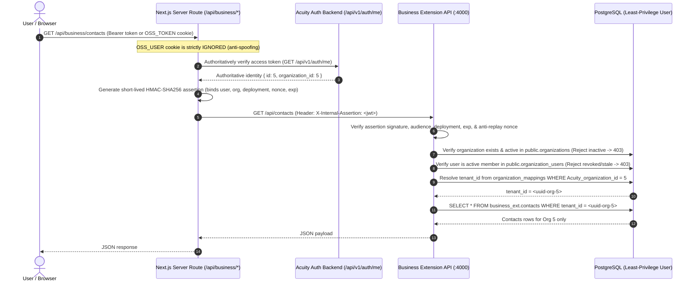

# Architecture Specification: AI Calling Agent OS Business Extension

## 1. System Vision & Guiding Principles

This architecture establishes a selective, high-integrity migration of commercial business capabilities from the custom **AI Calling Agent OS** codebase into **Acuity**, an open-source voice-agent platform.

### Core Architectural Decisions
1. **Reuse Acuity Platform Foundation**:
   - Acuity provides the FastAPI core, organization auth, drag-and-drop workflow builder, Pipecat conversational runtime, OpenAI/Gemini realtime audio adapters, telephony bridges (SIP, WebRTC, Asterisk/FreeSWITCH), campaign scheduling, recordings/transcripts, and tool execution.
   - **Under no circumstances is a secondary voice runtime, prompt resolution engine, or user authentication system introduced.**
2. **Isolated Business Extension Service**:
   - Business capabilities (CRM, business profiles, lead lifecycles, and future commercial tool policies) reside in a modular TypeScript service located under `extensions/business-api/`.
   - Acuity's Python codebase remains 100% upstream-compatible with zero core table alterations or monkey patching.
3. **Dedicated Schema Isolation**:
   - All business entities live exclusively within a dedicated PostgreSQL schema (`business_ext`), co-located in the same database engine but strictly decoupled from Acuity's `public` schema.
4. **Authoritative Ownership**:
   - Acuity is authoritative for: organizations, users, API keys, workflows, workflow definitions, voice sessions, runs, audio files, and raw execution logs.
   - Business Extension is authoritative for: business domain profiles, operating schedules, CRM contacts, lead statuses, timeline audit logs, and derived business outcomes.
5. **Durable, Explicit Multi-Tenant Binding**:
   - Identity is resolved through a durable cryptographic or verified server mapping: `(deployment_id, Acuity_organization_id) <-> business_tenant_id`.
   - Request-level organization IDs or tenant IDs provided in request bodies or query parameters are never trusted as proof of ownership.

---

## 2. Target Repository Topology

```text
Acuity/
├── api/                           # Acuity FastAPI core application (unmodified)
│   ├── routes/
│   ├── services/
│   └── db/
├── ui/                            # Acuity Next.js App Router frontend
│   ├── src/
│   │   ├── app/
│   │   │   ├── business/          # New business profile & CRM views
│   │   │   └── api/business/      # Authenticated server-side API proxy routes
│   │   ├── components/
│   │   │   └── business/          # Modern CRM & profile components
│   │   └── config/
│   │       └── branding.ts        # Centralized product branding configuration
├── pipecat/                       # Pinned Git submodule (unmodified)
├── extensions/
│   └── business-api/              # Isolated TypeScript Business Extension Service
│       ├── package.json
│       ├── tsconfig.json
│       ├── migrations/            # Isolated business_ext DDL
│       │   └── 001_business_ext_init.sql
│       └── src/
│           ├── config/            # Env and database config
│           ├── domain/            # Pure domain models & Zod schemas
│           ├── repositories/      # PostgreSQL data access layer
│           ├── services/          # Business logic & state machines
│           ├── adapters/          # Acuity API client adapter
│           ├── middleware/        # Org auth & error handling
│           ├── routes/            # REST API endpoints
│           └── tests/             # Unit and integration test suites
└── docs/
    └── business-extension/
        ├── MIGRATION_MATRIX.md
        ├── ARCHITECTURE.md
        └── VERIFICATION.md
```

---

## 3. Entity Ownership & Boundary Mapping

| Entity | Owning System | Authoritative Storage | Cross-Boundary Representation |
|---|---|---|---|
| **Organization / Account** | Acuity | `public.organizations` | Mapped to `business_ext.organization_mappings` |
| **User Identity & Auth** | Acuity | `public.users` | Transmitted via verified Bearer JWT or API key |
| **Workflow Definition** | Acuity | `public.workflow_definitions` | Referenced as `Acuity_workflow_id` (integer) |
| **Voice Call / Run** | Acuity | `public.workflow_runs` | Referenced as `Acuity_run_id` (UUID / string) |
| **Audio & Transcripts** | Acuity | MinIO / S3 (`voice-audio`) | Not duplicated; linked via Acuity run references |
| **Business Profile** | Business Extension | `business_ext.business_profiles` | Links to Acuity `workflow_id` |
| **CRM Contact** | Business Extension | `business_ext.contacts` | Scoped by `tenant_id` |
| **Interaction History** | Business Extension | `business_ext.interactions` | Records business outcomes correlated to `Acuity_run_id` |
| **Lead Audit Timeline** | Business Extension | `business_ext.contact_timeline_events`| Scoped by `(tenant_id, contact_id)` |

---

## 4. Multi-Tenant Identity Architecture

### Mapping Model
A durable mapping table in `business_ext` binds the Acuity organization to a unique business tenant:

```sql
CREATE TABLE IF NOT EXISTS business_ext.organization_mappings (
    id UUID PRIMARY KEY DEFAULT gen_random_uuid(),
    deployment_id VARCHAR(100) NOT NULL DEFAULT 'default',
    Acuity_organization_id INTEGER NOT NULL,
    business_tenant_id UUID NOT NULL DEFAULT gen_random_uuid(),
    created_at TIMESTAMPTZ NOT NULL DEFAULT NOW(),
    updated_at TIMESTAMPTZ NOT NULL DEFAULT NOW(),
    CONSTRAINT uq_deployment_org UNIQUE (deployment_id, Acuity_organization_id),
    CONSTRAINT uq_business_tenant UNIQUE (business_tenant_id)
);
```

### Authorization Flow


### Security Safeguards & Cryptographic Boundary Architecture
1. **Zero Cookie Claim Authority**: `OSS_USER` cookie contents are completely ignored for authorization. Identity and active organization are resolved exclusively via authenticated server-side calls to Acuity core backend (`/api/v1/auth/me`).
2. **Cryptographically Signed Internal Assertions**:
   - The UI proxy signs short-lived (60s TTL) HS256 HMAC assertions using a high-entropy secret (`BUSINESS_EXT_SECRET`, minimum 32 chars).
   - Assertion binds verified user (`sub`), verified organization (`org`), server-configured deployment ID (`dep`), audience (`business-extension-api`), issuer (`Acuity-ui-proxy`), issued-at (`iat`), expiration (`exp`), and unique nonce (`nonce`).
   - Any caller-supplied spoofed headers (`X-Acuity-Organization-Id`, `X-Acuity-Deployment-Id`, `X-Extension-Secret`) are stripped at the proxy.
3. **Replay & Mutation Protection**: In-memory nonce tracking cache prevents replay of consequential mutations (e.g., duplicated contact creation, updates, or deletions). Replayed assertions fail closed with `401 Unauthorized`.
4. **Hardened Configuration & Fail-Closed Startup**:
   - Publicly known development secrets are blocked (`KNOWN_INSECURE_SECRETS`). Missing, short (<32 chars), or insecure secrets cause immediate startup failure (`Fatal configuration error`).
   - Secrets are scrubbed from all logs, error objects, and test outputs.
5. **Private Ingress Isolation**: Business API binds strictly to `127.0.0.1` (loopback / private interface), blocking direct public ingress in deployed environments.
6. **Authoritative Membership & Active Org Verification**:
   - `verifyOrganizationActive(payload.org)`: Verifies organization exists and is active in Acuity's `public.organizations`.
   - `verifyUserOrganizationMembership(payload.sub, payload.org)`: Authoritatively checks Acuity's `public.organization_users` to deny revoked memberships or stale organization selections (`403 Forbidden`).
7. **Cross-Tenant Resource Verification**:
   - `verifyWorkflowOwnership(AcuityOrgId, workflowId)`: Blocks binding foreign workflows to business profiles (`403 Forbidden`).
   - `verifyWorkflowDefinitionOwnership(AcuityOrgId, definitionId, workflowId)`: Blocks associating foreign workflow versions.
   - `verifyRunOwnership(AcuityOrgId, runId, workflowId)`: Blocks associating foreign call runs with CRM interactions.
8. **Cross-Tenant Data Isolation**: Every database query in `business_ext` includes parameterized `WHERE tenant_id = $1` filters. Foreign access attempts return `404 Not Found` to prevent entity enumeration.
9. **Least-Privilege Database Role (`business_app_user`)**:
   - Executes with `NOSUPERUSER NOCREATEDB NOCREATEROLE NOINHERIT` (`rolsuper = f`).
   - Granted full DDL/DML privileges exclusively on the `business_ext` schema.
   - Granted strictly read-only `SELECT` access on Acuity's `public.organizations`, `public.workflows`, `public.workflow_definitions`, `public.workflow_runs`, `public.users`, and `public.organization_users`.
   - Direct write attempts to `public.*` tables are denied at the database engine level with `insufficient_privilege` (`42501`).

---

## 5. Phased Implementation Roadmap

### Stage 0: Repository Audit & Parity (Current)
- Complete source code inspection across PR #1, PR #2, and Acuity upstream checkout.
- Establish verified migration matrix and architectural boundaries.
- Ensure reproducible development environment and baseline test suite passage.

### Stage 1: Business Profile & CRM Foundation (Current)
- Isolated TypeScript Business Extension Service (`extensions/business-api/`).
- `business_ext` schema migrations with strict composite keys and indexes.
- Business Profile CRUD (with Acuity workflow binding, clean data).
- CRM Contact management, deterministic lead scoring, and timeline audit ledger.
- Interaction history linking Acuity `workflow_id`, `definition_id`, and `run_id`.
- Next.js authenticated server-side routes and modern dark/light UI views.
- Centralized provisional branding: **AI Calling Agent OS**.

### Stage 2: Escalations & Acuity Workflow Integration
- Escalation tickets, urgency classification, and on-call supervisor notifications.
- Acuity workflow HTTP tool node invoking Business Extension APIs during calls.
- Ingestion of post-call webhooks with signature verification and idempotency deduplication.

### Stage 3: Bookings & Commercial Tool Policies
- Idempotent appointment booking lifecycle (`pending` -> `confirming` -> `confirmed`).
- Tenant-bound Google Calendar / Cal.com OAuth token vault.
- Tool Marketplace commercial entitlements and high-risk action approval gates.

### Stage 4: Script Intelligence & Observability
- Outcome-based script analysis: correlate Acuity call QA scores and LLM costs with CRM conversion rates.
- Experiment cohorts and A/B traffic split outcome tracking.
