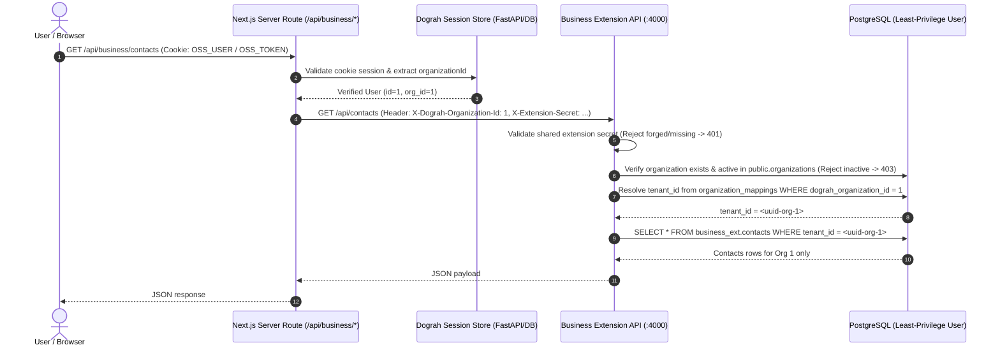

# Architecture Specification: AI Calling Agent OS Business Extension

## 1. System Vision & Guiding Principles

This architecture establishes a selective, high-integrity migration of commercial business capabilities from the custom **AI Calling Agent OS** codebase into **Dograh**, an open-source voice-agent platform.

### Core Architectural Decisions
1. **Reuse Dograh Platform Foundation**:
   - Dograh provides the FastAPI core, organization auth, drag-and-drop workflow builder, Pipecat conversational runtime, OpenAI/Gemini realtime audio adapters, telephony bridges (SIP, WebRTC, Asterisk/FreeSWITCH), campaign scheduling, recordings/transcripts, and tool execution.
   - **Under no circumstances is a secondary voice runtime, prompt resolution engine, or user authentication system introduced.**
2. **Isolated Business Extension Service**:
   - Business capabilities (CRM, business profiles, lead lifecycles, and future commercial tool policies) reside in a modular TypeScript service located under `extensions/business-api/`.
   - Dograh's Python codebase remains 100% upstream-compatible with zero core table alterations or monkey patching.
3. **Dedicated Schema Isolation**:
   - All business entities live exclusively within a dedicated PostgreSQL schema (`business_ext`), co-located in the same database engine but strictly decoupled from Dograh's `public` schema.
4. **Authoritative Ownership**:
   - Dograh is authoritative for: organizations, users, API keys, workflows, workflow definitions, voice sessions, runs, audio files, and raw execution logs.
   - Business Extension is authoritative for: business domain profiles, operating schedules, CRM contacts, lead statuses, timeline audit logs, and derived business outcomes.
5. **Durable, Explicit Multi-Tenant Binding**:
   - Identity is resolved through a durable cryptographic or verified server mapping: `(deployment_id, dograh_organization_id) <-> business_tenant_id`.
   - Request-level organization IDs or tenant IDs provided in request bodies or query parameters are never trusted as proof of ownership.

---

## 2. Target Repository Topology

```text
dograh/
├── api/                           # Dograh FastAPI core application (unmodified)
│   ├── routes/
│   ├── services/
│   └── db/
├── ui/                            # Dograh Next.js App Router frontend
│   ├── src/
│   │   ├── app/
│   │   │   ├── business/          # New business profile & CRM views
│   │   │   └── api/business/      # Authenticated server-side API proxy routes
│   │   ├── components/
│   │   │   └── business/          # Modern CRM & profile components
│   │   └── config/
│   │       └── branding.ts        # Centralized product branding configuration
├── pipecat/                       # Pinned Git submodule (unmodified)
├── extensions/
│   └── business-api/              # Isolated TypeScript Business Extension Service
│       ├── package.json
│       ├── tsconfig.json
│       ├── migrations/            # Isolated business_ext DDL
│       │   └── 001_business_ext_init.sql
│       └── src/
│           ├── config/            # Env and database config
│           ├── domain/            # Pure domain models & Zod schemas
│           ├── repositories/      # PostgreSQL data access layer
│           ├── services/          # Business logic & state machines
│           ├── adapters/          # Dograh API client adapter
│           ├── middleware/        # Org auth & error handling
│           ├── routes/            # REST API endpoints
│           └── tests/             # Unit and integration test suites
└── docs/
    └── business-extension/
        ├── MIGRATION_MATRIX.md
        ├── ARCHITECTURE.md
        └── VERIFICATION.md
```

---

## 3. Entity Ownership & Boundary Mapping

| Entity | Owning System | Authoritative Storage | Cross-Boundary Representation |
|---|---|---|---|
| **Organization / Account** | Dograh | `public.organizations` | Mapped to `business_ext.organization_mappings` |
| **User Identity & Auth** | Dograh | `public.users` | Transmitted via verified Bearer JWT or API key |
| **Workflow Definition** | Dograh | `public.workflow_definitions` | Referenced as `dograh_workflow_id` (integer) |
| **Voice Call / Run** | Dograh | `public.workflow_runs` | Referenced as `dograh_run_id` (UUID / string) |
| **Audio & Transcripts** | Dograh | MinIO / S3 (`voice-audio`) | Not duplicated; linked via Dograh run references |
| **Business Profile** | Business Extension | `business_ext.business_profiles` | Links to Dograh `workflow_id` |
| **CRM Contact** | Business Extension | `business_ext.contacts` | Scoped by `tenant_id` |
| **Interaction History** | Business Extension | `business_ext.interactions` | Records business outcomes correlated to `dograh_run_id` |
| **Lead Audit Timeline** | Business Extension | `business_ext.contact_timeline_events`| Scoped by `(tenant_id, contact_id)` |

---

## 4. Multi-Tenant Identity Architecture

### Mapping Model
A durable mapping table in `business_ext` binds the Dograh organization to a unique business tenant:

```sql
CREATE TABLE IF NOT EXISTS business_ext.organization_mappings (
    id UUID PRIMARY KEY DEFAULT gen_random_uuid(),
    deployment_id VARCHAR(100) NOT NULL DEFAULT 'default',
    dograh_organization_id INTEGER NOT NULL,
    business_tenant_id UUID NOT NULL DEFAULT gen_random_uuid(),
    created_at TIMESTAMPTZ NOT NULL DEFAULT NOW(),
    updated_at TIMESTAMPTZ NOT NULL DEFAULT NOW(),
    CONSTRAINT uq_deployment_org UNIQUE (deployment_id, dograh_organization_id),
    CONSTRAINT uq_business_tenant UNIQUE (business_tenant_id)
);
```

### Authorization Flow


### Security Safeguards & Least-Privilege Architecture
1. **No Client-Supplied Tenant Authority**: The browser cannot pass `tenant_id` or `organization_id` to override server-determined context. Any client-provided tenant headers are stripped before processing.
2. **Server-Side Proxy Gating**: Next.js API routes (`ui/src/app/api/business/*`) authenticate the session via `getServerUser()` before relaying to the Business API.
3. **Internal Secret Defense**: Business API strictly verifies `X-Extension-Secret`. Public or forged direct requests immediately fail-closed with `401 Unauthorized`.
4. **Active Organization Verification**: Incoming organizations are verified against Dograh's `public.organizations` (`verifyOrganizationActive`). Non-existent or disabled organizations return `403 Forbidden`.
5. **Cross-Tenant Resource Verification**:
   - `verifyWorkflowOwnership(dograhOrgId, workflowId)`: Blocks binding foreign workflows to business profiles.
   - `verifyWorkflowDefinitionOwnership(dograhOrgId, definitionId, workflowId)`: Blocks associating foreign workflow versions.
   - `verifyRunOwnership(dograhOrgId, runId, workflowId)`: Blocks associating foreign call runs with CRM interactions.
6. **Cross-Tenant Data Isolation**: Every database query in `business_ext` includes `WHERE tenant_id = $1` with parameterized bindings. Cross-tenant access attempts return `404 Not Found` to prevent entity enumeration.
7. **Least-Privilege Database User (`business_app_user`)**:
   - Executes with `NOSUPERUSER NOCREATEDB NOCREATEROLE NOINHERIT` (`rolsuper = f`).
   - Granted full DDL/DML privileges exclusively on the `business_ext` schema.
   - Granted strictly read-only `SELECT` access on Dograh's `public.organizations`, `public.workflows`, `public.workflow_definitions`, `public.workflow_runs`, and `public.users`.
   - Direct write attempts to `public.*` tables are denied at the database engine level with `insufficient_privilege` (`42501`).

---

## 5. Phased Implementation Roadmap

### Stage 0: Repository Audit & Parity (Current)
- Complete source code inspection across PR #1, PR #2, and Dograh upstream checkout.
- Establish verified migration matrix and architectural boundaries.
- Ensure reproducible development environment and baseline test suite passage.

### Stage 1: Business Profile & CRM Foundation (Current)
- Isolated TypeScript Business Extension Service (`extensions/business-api/`).
- `business_ext` schema migrations with strict composite keys and indexes.
- Business Profile CRUD (with Dograh workflow binding, clean data).
- CRM Contact management, deterministic lead scoring, and timeline audit ledger.
- Interaction history linking Dograh `workflow_id`, `definition_id`, and `run_id`.
- Next.js authenticated server-side routes and modern dark/light UI views.
- Centralized provisional branding: **AI Calling Agent OS**.

### Stage 2: Escalations & Dograh Workflow Integration
- Escalation tickets, urgency classification, and on-call supervisor notifications.
- Dograh workflow HTTP tool node invoking Business Extension APIs during calls.
- Ingestion of post-call webhooks with signature verification and idempotency deduplication.

### Stage 3: Bookings & Commercial Tool Policies
- Idempotent appointment booking lifecycle (`pending` -> `confirming` -> `confirmed`).
- Tenant-bound Google Calendar / Cal.com OAuth token vault.
- Tool Marketplace commercial entitlements and high-risk action approval gates.

### Stage 4: Script Intelligence & Observability
- Outcome-based script analysis: correlate Dograh call QA scores and LLM costs with CRM conversion rates.
- Experiment cohorts and A/B traffic split outcome tracking.
